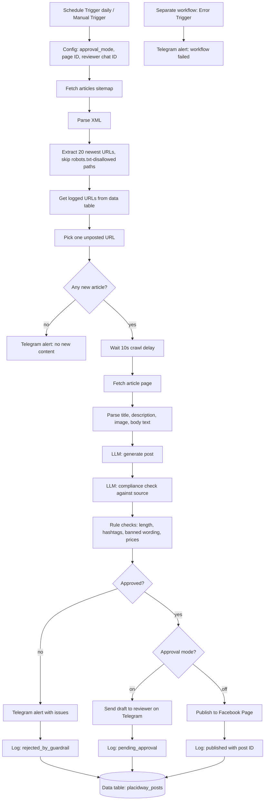
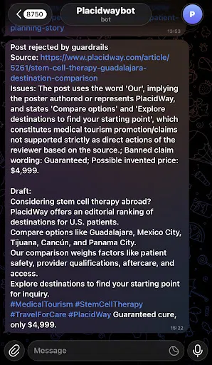
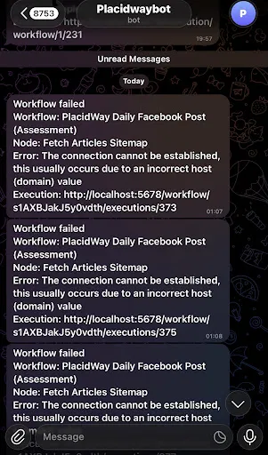

# PlacidWay Daily Facebook Post Automation

An n8n workflow that turns publicly available PlacidWay articles into one on-brand Facebook post per day, without anyone copying and pasting. It reads the site's sitemap, picks an article that has not been used before, drafts a post with an LLM, checks the draft with two layers of guardrails, and then either sends it to a human reviewer (approval mode) or publishes it to a test Facebook Page. Every run is logged, failures trigger an alert, and no URL is ever posted twice.

Built as the first version of a content pipeline for the PlacidWay AI Automation Candidate Assessment.

**Status:** the workflow runs end to end in approval mode: extraction, selection, post generation, guardrails, Telegram review, logging and failure alerts. Live publishing to Facebook is built but **not tested**, because Facebook returned a generic "An error occurred while creating the page" error each time I tried to create a test Page. I therefore ran in the draft/simulation mode the assessment allows. Details are under [Known limitations](#known-limitations).

## Contents

- [What it replaces](#what-it-replaces)
- [Architecture](#architecture)
- [How it meets the requirements](#how-it-meets-the-requirements)
- [Repository contents](#repository-contents)
- [Setup](#setup)
- [Configuration reference](#configuration-reference)
- [How to run](#how-to-run)
- [Design decisions](#design-decisions)
- [Guardrails in detail](#guardrails-in-detail)
- [Sample output](#sample-output)
- [Testing](#testing)
- [Known limitations](#known-limitations)
- [Possible next steps](#possible-next-steps)
- [Author](#author)

## What it replaces

Without automation, a marketing team member does this every day: browse the site for something fresh, check it has not been posted before, read the article, write a post with a hook, value lines, call to action and hashtags, check it for medical claims and invented facts, paste the link and image into Facebook, and record what was posted. This workflow performs the whole sequence and leaves a person with one small job: reading a finished, already-checked draft and approving it.

## Architecture



| Component | Choice |
|---|---|
| Automation platform | n8n (self-run, SQLite) |
| Post writer | Google Gemini 2.5 Flash |
| Compliance checker | Google Gemini 3.5 Flash-Lite (a second, different model keeps the check independent of the writer and spreads free-tier quota) |
| Review and alerts | Telegram bot |
| Store and run log | n8n Data table (`placidway_posts`) |
| Publishing | Facebook Graph API `POST /{page-id}/feed` |

## How it meets the requirements

| Requirement | Implementation |
|---|---|
| Runs once a day, plus manual run | Schedule Trigger (daily) and Manual Trigger, both feeding the same Config node |
| Extract title, URL, text and image | URLs from the sitemap; title, description and image from the article page's `og:` meta tags; body text from the page HTML |
| One item per run, never the same URL twice | A data table of every URL already handled (published, drafted or rejected); the picker skips anything in it |
| LLM-written post under 500 characters | Prompt asks for a hook, 2-4 short lines, a call to action and 3-5 hashtags; length is also enforced in code; the link is appended afterwards |
| Guardrails (no medical claims, outcome promises, invented prices or unsupported facts) | Two layers: a second LLM review against the source text, and deterministic rule checks |
| Publish or schedule to a test Page, with image | Graph API post with `message` and `link`, so Facebook builds the link preview and image itself |
| Auto-publish / approval switch | `approval_mode` flag in the Config node |
| Logging, retries and alerts | Every run is logged; HTTP and model calls retry; a separate error workflow sends a Telegram alert when a scheduled run fails |

## Repository content

| File | Purpose |
|---|---|
| `placidway_social_full.json` | The main workflow |
| `placidway_error_alert.json` | The error-alert workflow (Error Trigger to Telegram message) |
| `workflow-canvas.png` | The main workflow on the n8n canvas |
| `Data-table.png` | The log and never-post-twice data table |
| `guardrail-rejection.png.webp`, `failure-alert.png.webp` | Evidence from the guardrail and failure tests |
| `README.md` | This document |

## Setup

**Requirements:** a recent n8n version that includes Data tables, a Google AI Studio API key, a Telegram bot token, and optionally a Facebook test Page with a Page access token.

1. **Import both workflows.** In n8n create a new workflow, open the menu, choose *Import from file*, and select `placidway_social_full.json`. Repeat in a second, separate new workflow with `placidway_error_alert.json`.
2. **Create the data table.** Name it `placidway_posts` with six text columns: `url`, `title`, `status`, `post_text`, `fb_post_id`, `ran_at`. Open the **Get Logged URLs** and **Log Run** nodes and select this table.
3. **Add credentials in n8n.** No environment variables are required. Secrets live in n8n's credential store and are not included in exported workflow files.
   - *Google Gemini (PaLM) API*: attach to **Gemini Model (Generate)** and **Gemini Model (Check)**.
   - *Telegram API* (token from @BotFather): attach to **Alert No Content**, **Alert Rejected** and **Send Draft to Reviewer** in the main workflow, and to **Alert Error** in the `PlacidWay Error Alert` workflow.
   - *Facebook Graph API* (Page access token): attach to **Publish to Facebook**. Only needed for auto-publish mode.
4. **Edit the Config node** (see the reference below), and type your Telegram chat ID directly into the **Alert Error** node in the error workflow, which cannot read from Config.
5. **Connect the error workflow.** In the main workflow's *Settings*, set *Error workflow* to `PlacidWay Error Alert`. n8n does not allow a workflow to be its own error handler in the version used here, so the alert lives in a separate workflow.
6. Keep the main workflow unpublished while testing. Publish it when you want the daily schedule to run.

Never commit tokens or API keys to the repository.

## Configuration reference

**Config node values**

| Field | Meaning |
|---|---|
| `approval_mode` | `true`: send the draft to the reviewer on Telegram. `false`: publish to the Facebook Page |
| `fb_page_id` | ID of the test Facebook Page (used only in auto-publish mode) |
| `reviewer_chat_id` | Telegram chat ID that receives drafts and alerts |

**Data table `placidway_posts`**

| Column | Content |
|---|---|
| `url` | Source article URL (the never-post-twice key) |
| `title` | Article title |
| `status` | `published`, `pending_approval` or `rejected_by_guardrail` |
| `post_text` | The generated post, including the link when it was drafted or published |
| `fb_post_id` | Facebook post ID (empty unless published) |
| `ran_at` | Timestamp of the run |

## How to run

- **Manual test:** click *Execute workflow*. One run takes about a minute (10 seconds of that is the crawl-delay wait).
- **Approval mode (`true`, the recommended default):** the draft arrives on Telegram and is logged as `pending_approval`.
- **Auto-publish (`false`):** the post is sent to the Facebook Page and logged as `published` with its post ID.
- **Daily operation:** publish the main workflow; it runs once a day on its schedule.
- **Reset an article:** delete its row from `placidway_posts` and it becomes eligible again.

## Design decisions

**Extraction: the site's sitemap.** `robots.txt` lists `https://www.placidway.com/sitemap.xml`, an index with a separate sitemap per content type. The workflow uses `sitemap_articles.xml` because it is the site's own published list of URLs, it needs one request instead of crawling listing pages, it includes `lastmod` so the newest content can be sorted first, and it avoids fragile scraping of page layouts. Each chosen article is then read with a single request, taking title, description and image from the standard `og:` meta tags, which are more stable than page markup. An RSS feed or a headless browser would add cost without benefit here.

**Respecting robots.txt.** `robots.txt` allows `/` for all agents and sets `Crawl-delay: 10`. The workflow makes two requests per run (one sitemap, one article) with a 10-second wait between page fetches, and identifies itself in the `User-Agent` header. A filter in code drops any URL under a disallowed path (`/api/v1/`, `/ajax/`, `/data/`, `/uploads/`, `/blog_old/`, `/blog_include/`, `/solutions/`, `/language/`). The page image is never downloaded; Facebook fetches the preview image itself from the linked article, which avoids touching disallowed paths. Only public pages are read, and nothing is posted to any PlacidWay page.

**Never posting the same URL twice.** A data table stores every URL that has been published, drafted or rejected. Rejected URLs are stored too, so one failing article cannot block the workflow forever. Each run reads the table, removes known URLs from the 20 newest candidates, and picks the first remaining one.

**Approval mode.** A flag in the Config node switches between sending a draft to a reviewer and publishing. The first version is deliberately conservative: it should run in approval mode until the guardrails have been tuned on more articles.

**Failures, retries and alerts.** HTTP request nodes retry up to three times with a delay, and the model calls are set to retry on temporary errors such as HTTP 503 overload from Gemini. If a scheduled run still fails, the `PlacidWay Error Alert` workflow sends a Telegram message naming the workflow, the failing node and the error. A separate alert fires when no unposted article is available. The compliance check fails closed: if the checker cannot run, the workflow errors and alerts instead of posting unchecked content.

**Prompt changes after testing.** Testing on harder articles exposed gaps, described under [Sample output](#sample-output). The generator prompt now forbids superlatives and any description of the quality, skill or reputation of doctors, hospitals, clinics or countries, even when the source uses such wording, and the banned-word list was widened to match.

## Guardrails in detail

A post is approved only if every layer agrees.

**Layer 1: second LLM pass.** A separate model call compares the draft to the source text and returns `{"pass": true/false, "issues": [...]}`. It fails posts that make medical claims, imply outcomes, state a price not in the source, or state any fact the source does not support.

**Layer 2: deterministic rules in code.**

| Rule | Behaviour |
|---|---|
| Length | Fails if the post exceeds 500 characters before the link |
| Hashtags | Fails unless the post has 3 to 5 hashtags |
| Banned wording | Fails on claim words such as cure, guarantee, risk-free, miracle, painless, no side effects, safe and effective, world-class, best, leading, state-of-the-art, life-saving, high-quality, renowned, exceptional, unmatched, skillful, esteemed |
| Invented prices | Fails if the post contains a currency amount that does not appear in the source text |
| Thin source | Fails if the page has too little usable text |

The generator prompt itself instructs the model to use only facts from the source, avoid medical claims and outcome promises, and avoid prices and statistics not in the source.

## Sample output

Each post below was checked by hand against its source page. The rule versions are noted because the prompt and banned-word list were tightened during testing.

**Sample 1: Heart transplantation in Saudi Arabia** (after the superlatives prompt fix)
Source: https://www.placidway.com/article/9843/Heart-Transplantation-in-Saudi-Arabia-Bringing-New-Hope-to-Patients-Through-Coordinated-Multi-City-Organ-Donation

```
Explore heart transplantation in Saudi Arabia.
KFSHRC in Riyadh performs these procedures.
It involves coordinated multi-city organ donation, with hearts retrieved from Abu Dhabi, Jeddah, and Riyadh.
Operations are led by cardiac specialists, adhering to a strict 5-hour transport window.
Learn more about these procedures.
#HeartTransplant #SaudiArabia #MedicalTourism #KFSHRC
```

Result: approved, no issues. The hospital, the donor cities and the transport window all appear in the article.

**Sample 2: Orthopedic surgery in Mexico** (after the tightened rules)
Source: https://www.placidway.com/article/5295/orthopedic-surgery-mexico-us-patient-planning-story

```
Planning orthopedic surgery in Mexico?
Explore considerations for implants, rehabilitation, and travel.
Learn how to compare options and create a recovery plan.
Understand itemized quotes for services like surgeon and hospital room.
Factor in additional costs such as pre-op work and lodging.
Plan your journey with helpful insights.
#MedicalTourism #OrthopedicSurgery #MexicoHealth #PatientPlanning
```

Result: approved, no issues. The article contains many price ranges; the post correctly left them all out.

**Sample 3: Stem cell therapy destinations** (after the tightened rules)
Source: https://www.placidway.com/article/5261/stem-cell-therapy-guadalajara-destination-comparison

```
Considering stem cell therapy abroad?
We compare destinations like Guadalajara, Mexico City, and Panama City.
Our ranking considers factors such as travel access, aftercare, and provider checks for U.S. patients.
This helps you start your inquiry, with emphasis on safety and regulatory transparency.
Explore options to plan your medical journey.
#MedicalTourism #StemCellTherapy #TravelForHealth #PlacidWay
```

Result: approved, no issues. Every statement matches the article. The source is a cautionary guide, and the post does not carry that caution over, which is why sensitive topics need human review (see [Known limitations](#known-limitations)).

**A gap found in testing: Istanbul hospitals** (before the tightened rules)
Source: https://www.placidway.com/article/2069/Best-Hospitals-in-Istanbul-Turkey

The first draft said Istanbul has "professional, high-quality doctors". The phrase comes from the article's own promotional text, so the "only facts in the source" check correctly passed it, and it was not yet in the banned list. It is still an unverifiable quality claim. I added the prompt rule and the banned words described above, and a rerun of the same article no longer used the phrase.

A similar case came up earlier with the heart transplantation article, whose own summary calls a hospital's infrastructure "world-class". The first draft repeated it, which led to the superlatives rule.

## Testing

**Guardrail rejection test.** To prove the checks block bad content, I temporarily appended "Guaranteed cure, only $4,999." to a real draft (the stem cell post) and ran the workflow. The post was rejected, a Telegram alert listed the issues, and the run was logged as `rejected_by_guardrail`. The alert named the banned claim wording ("Guaranteed") and the possible invented price ($4,999). The second-pass LLM reviewer also returned comments, but they concerned other phrases in the draft ("Our", "Compare options"), not the injected claim. This shows why there are two layers: the deterministic rules caught the claims reliably, while the LLM reviewer's judgement varies between runs. The test line was removed afterwards.



**Failure alert test.** To prove failures are not silent, I temporarily replaced the sitemap URL with an unresolvable domain, set the schedule to run every minute, and published the workflow. The scheduled runs failed at **Fetch Articles Sitemap** after the retries, and the Telegram alert arrived naming the workflow, that node and the connection error. I then restored the real URL and the daily schedule. n8n only triggers an error workflow for automatic runs, not for runs started with the Execute button, so this test had to run on the schedule.



**Other checks.** The never-post-twice rule was confirmed by running the workflow repeatedly: each run chose a different article because earlier URLs were logged. Each sample post was verified by hand against its source page.

## Known limitations

- **Live Facebook publishing is untested.** Creating a test Page failed repeatedly with a generic Facebook error, so the **Publish to Facebook** node has never run against a real Page. It is configured to POST `message` and `link` to the Page feed (`/{page-id}/feed`) using a Page access token stored in an n8n Facebook Graph API credential. To test it: create a Page, add the Page token to the credential, set `fb_page_id` in Config, set `approval_mode` to `false`, and run. The Graph API version in the URL (`v21.0`) may need updating.
- **Approval is manual.** The reviewer receives the draft on Telegram, but there is no approve button that triggers publishing. A next step would be n8n's send-and-wait approval, which continues the workflow when the reviewer approves.
- **The LLM reviewer is not deterministic.** Across runs it sometimes flags harmless phrases and can miss others. The rule checks are the reliable layer; the reviewer adds a second opinion.
- **Sensitive topics need a human.** The rules check wording, not topic risk. A stem cell post passed every check even though its source is a cautionary guide and the post dropped that caution. Approval mode exists for this reason.
- **Banned words are blunt.** The list blocks words such as "best" even when the source uses them. This is intentional for a medical brand, but it can reject acceptable posts.
- **Rate limits and overload.** The free Gemini tier can return 429 or 503 errors. Retries help, but a run can still fail and alert.
- **Plain-text scraping.** Pages with heavy scripts or unusual markup can yield noisy text; the workflow rejects posts when too little usable text is found.
- **No variety control.** Articles are picked newest-first with no balancing across categories.
- **Local alert links.** The execution link in the failure alert points to a local n8n address, so it only opens on the machine running n8n.

## Possible next steps

- Test live publishing on a Facebook test Page, and add a review step that publishes on approval.
- Force approval mode automatically for a sensitive-topic list (stem cell, cancer, transplant and similar).
- Add an `issues` column to the log so rejection reasons are stored with the run.
- Variety rules: rotate between content types and treatment categories across the week.
- Image handling, cross-posting to Instagram or LinkedIn, a dashboard of scheduled and published posts, and engagement read-back stored next to each post.

## Author

Olalekan Adeola, AI & Automation Engineer.
GitHub: github.com/Deoh645 | LinkedIn: linkedin.com/in/olalekan-adeola
